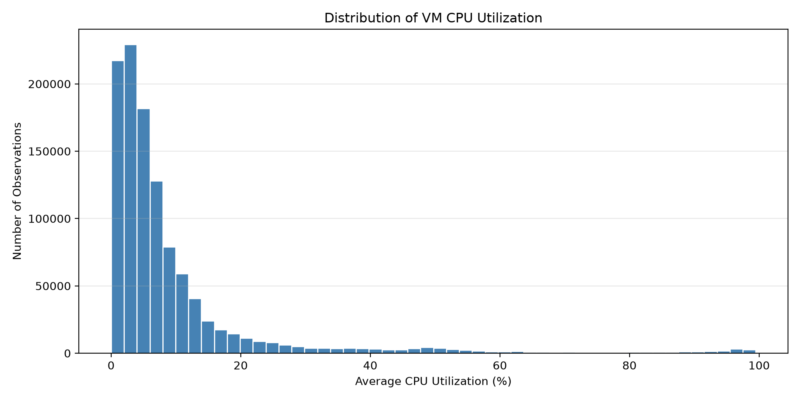
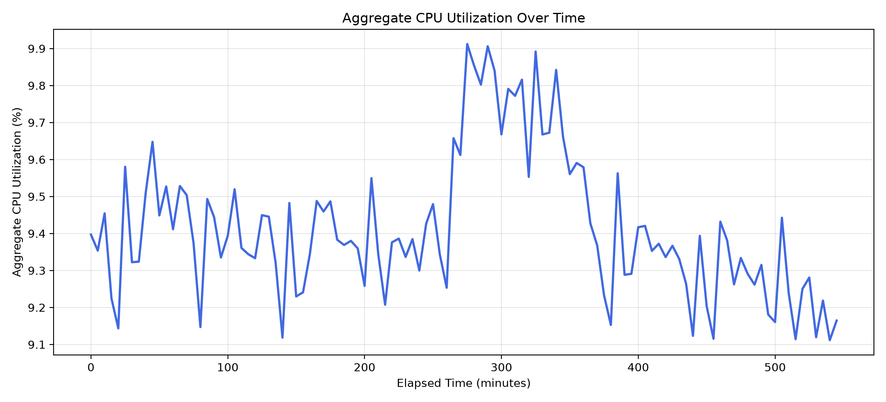

# Cloud Workload Forecasting & Analysis

**Atomity AI/ML Internship Assignment — Technical Report**  
Evaluation uses the public training window only; [final forecasts](../predictions.csv) are exported without holdout scoring.

## 1. Executive Summary

This study forecasts near-term workload in a curated Microsoft Azure Public Dataset V2 subset: 10,000 VMs, 134 five-minute timestamps and 1,340,000 CPU readings. The required targets are active VM count and the unweighted mean of VM CPU utilization. Eight simple forecasting methods were evaluated on three expanding training windows, each predicting two hours from one origin.

Ridge autoregression with six lags achieved the lowest pooled CPU MAE, **0.17292 percentage points**, and RMSE, **0.21507**, improving on persistence by **16.95%** and **19.86%**, respectively. Moving Average (12) remains a sensible fallback. VM-count persistence had zero validation error for the fixed observed population.

The operational recommendation is **shadow monitoring and decision support only, without automatic scaling**. Historical error margins reduced numerical underprediction but failed to detect either elevated-demand event in the comparable policy replay. Three validation windows, few peaks and no physical capacity telemetry limit both model-ranking confidence and operational conclusions.

## 2. Dataset Understanding and Preprocessing

The challenge's fixed `data-v1` release is a curated derivative of [Microsoft Azure Public Dataset V2](https://github.com/Azure/AzurePublicDataset/blob/master/AzurePublicDatasetV2.md). Its two input tables are VM-level interval CPU readings (`min_cpu`, `max_cpu`, `avg_cpu`) and VM metadata, including category, resource-size buckets and recorded lifetimes. These inputs differ from the two derived timestamp-level forecasting targets:

```text
active_vm_count(t) = number of distinct VMs with valid CPU readings at t
aggregate_cpu_utilization(t) = mean of VM-level avg_cpu at t
```

The release contains 134 observations per VM at 300-second cadence, spanning approximately 11.1 hours. The [release card](../challenge_data/DATA_CARD.md) documents selection of complete traces, stratified by category and virtual-core bucket. Project inspection found no missing CPU values, duplicate VM–timestamp pairs, invalid CPU ranges or missing metadata matches. The final prediction pipeline repeats these structural checks before aggregation and splitting; observed holdout targets are then discarded. The release card also documents cadence, completeness and population matching.

The existing EDA groups valid readings by timestamp, counts each VM once and averages `avg_cpu`. No imputation or resampling is needed for this complete grid. The full target series is constructed before the chronological split; all subsequent workload statistics, features and evaluation use training data only. Source-relative seconds are preserved, without invented calendar dates. The CPU target is **an unweighted mean of percentages**, not total CPU-core demand or host utilization; unequal VM sizes prevent its direct conversion into physical capacity requirements.

## 3. Exploratory Workload Analysis

Across the first 110 timestamps, aggregate CPU averages **9.4141%**, ranges from **9.1116% to 9.9122%**, and has a P95 of **9.8291%**. Active VM count is consistently **10,000**. Individual VM readings are strongly right-skewed (Figure 1): a low aggregate mean can conceal heavily utilized VMs.



*Figure 1. Training-only VM CPU readings concentrate near low utilization, with a long high-utilization tail. The aggregate mean does not describe every VM's resource pressure.*

Training category means are **11.51% Interactive**, **10.35% Unknown** and **8.26% Delay-insensitive**. These differences support investigation by workload category, not validated category-specific capacity rules. Interactive services may warrant closer latency protection if their SLOs require it; delay-insensitive work may allow scheduling flexibility; unknown workloads need classification.



*Figure 2. Aggregate utilization rises temporarily and then declines within the training window. This short trajectory does not establish daily or weekly seasonality.*

A metadata-only recheck confirms recorded creation timestamps are zero for all selected VMs and no recorded deletion lies within the 134-timestamp window. Zero is a source-relative boundary value, not proof of simultaneous real-world creation. Complete-trace selection and stable observed membership explain the constant count; they do not establish an absence of churn in real cloud deployments.

## 4. Forecasting Methodology

The first **110 observations** form the public training window; the final **24** are reserved for a two-hour holdout. Validation stays entirely within training:

| Fold | Training observations, inclusive | Validation observations, inclusive |
| --- | --- | --- |
| 1 | 1–38 | 39–62 |
| 2 | 1–62 | 63–86 |
| 3 | 1–86 | 87–110 |

Each method predicts the same 24 future timestamps from a single origin. Chronological validation represents forecasting information availability; random splitting could train on observations later than the prediction time. Earlier validation observations become legitimate history at subsequent origins. Within a forecast, actual future targets never enter recursive inputs.

Persistence repeats the last value; Moving Average (6)/(12) repeats the mean of the last six/twelve readings. Exponential Smoothing uses `alpha=0.3`, `adjust=False`, with a flat forecast. Linear Trend (12)/(24) extrapolates an ordinary least-squares slope fitted to that recent window. Ridge AR (3)/(6) fits lagged CPU values using `alpha=1.0`, centered inputs/targets and an unpenalized intercept, without variance scaling. Recursive predictions supply later lag inputs. Trend and ridge forecasts retain their original clipping to [0,100]. No model settings were changed during error, policy or report preparation.

Simple methods suit the limited history; additional complexity is not itself evidence of improvement. Final holdout targets are excluded from fitting, features, tuning, model selection, peak thresholds and uncertainty calibration. The final export processes raw readings for structural validation and target construction, retains only holdout timestamps for forecasting, and reports no final test performance.

## 5. Forecasting Results

MAE measures typical absolute error; RMSE gives greater weight to large misses. Both are computed from **72 pooled, unrounded validation errors per CPU method**, rather than averaging rounded fold metrics. CPU errors below are percentage points. Relative improvement is `100 × (persistence error − model error) / persistence error`; negative values indicate deterioration.

| CPU model | MAE | RMSE | MAE improvement | RMSE improvement |
| --- | ---: | ---: | ---: | ---: |
| Ridge AR (6) | **0.17292** | **0.21507** | **16.95%** | **19.86%** |
| Ridge AR (3) | 0.17323 | 0.21586 | 16.79% | 19.57% |
| Moving Average (12) | 0.17838 | 0.23220 | 14.32% | 13.48% |
| Exponential Smoothing | 0.20048 | 0.25512 | 3.71% | 4.94% |
| Persistence | 0.20820 | 0.26839 | 0.00% | 0.00% |
| Moving Average (6) | 0.21401 | 0.26903 | −2.79% | −0.24% |
| Linear Trend (24) | 0.36564 | 0.47574 | −75.62% | −77.26% |
| Linear Trend (12) | 0.43693 | 0.63037 | −109.86% | −134.87% |

Ridge AR (6) is provisionally preferred for its pooled metrics and lower worst-fold MAE than Moving Average (12). Its MAE advantage over that fallback is only **3.06%**; the three-lag ridge is also nearly tied. Moving Average (12) offers lower complexity and a strong counterexample to universal ridge superiority in the final validation window.

For active VM count, persistence achieves **MAE = RMSE = 0 VMs in every fold**. This justifies a constant forecast for the curated population, not a general cloud-churn model. Percentage improvement against its zero-error baseline is undefined and is not calculated.

## 6. Error Analysis and Limitations

Ridge AR (6) beats Moving Average (12) on MAE in two windows, but loses materially in the third:

| CPU method: MAE (percentage points) | Fold 1 | Fold 2 | Fold 3 |
| --- | ---: | ---: | ---: |
| Ridge AR (6) | 0.19012 | 0.13744 | 0.19119 |
| Moving Average (12) | 0.19633 | 0.21972 | 0.11910 |
| Persistence | 0.19468 | 0.29749 | 0.13243 |

Ridge's worst-fold MAE is **0.19119**, versus **0.21972** for the moving average. Linear Trend (12), the weakest pooled method, attains MAE **0.93709** in fold 2 despite winning fold 1. Extrapolating a local slope into a reversal is consistent with this failure; it is an interpretation of the observed trajectory, not a causal test.


*Figure 3. Errors generally increase in the second forecast hour, but six-step blocks are not monotonically worse. Rankings also depend on lead time.*

Ridge's first-/second-hour MAEs are **0.10757/0.23827**, compared with **0.08652/0.27025** for Moving Average (12). Thus the pooled winner is not uniformly best across horizons.

Peaks are actual values at or above each origin's **training-derived P95**. Folds contain **10, 2 and 0** such observations. Ridge peak MAE is **0.34613**, slightly worse than persistence's **0.33801**; there is no evidence of improved peak-demand detection. Empty peak subsets remain undefined. P95 identifies relative historical demand, not infrastructure saturation.

With `residual = actual − predicted`, Ridge's pooled bias is **−0.03484** and residual population SD is **0.21223**. It underpredicts **24** points and overpredicts **48**; its largest residuals are **+0.51347** and **−0.35269**. All **12** peak points are underpredicted, despite the negative overall bias. These opposite failure modes are obscured by average accuracy. Three overlapping training windows and correlated forecast errors cannot support a statistical-significance claim about ranking.

## 7. Operational Recommendations

**Use forecasts for shadow monitoring and decision support only; do not enable automatic scaling.** They can support early workload awareness, investigation and capacity-planning discussions, but do not quantify spare servers or verified service risk.

The illustrative upper forecast is:

```text
U = clip(prediction + max(0, historical Q90 residual), 0, 100)
```

Margins use same-model out-of-fold errors already resolved at the origin, separately for steps 1–12 and 13–24. Fold 2 calibrates from fold 1; fold 3 from folds 1–2. Fold 1 is explicitly uncalibrated. Q90 and Q95 are fixed illustrative comparisons, not policies optimized on these results or guaranteed prediction intervals. Model selection on these same windows can still make calibration optimistic.

Normal means `U < training P95`; Elevated means `U >= training P95`; High-risk begins at the third consecutive five-minute step with **point forecast >= training P95**. Runs reset at each origin. Alerts prompt investigation of actual headroom and service metrics; no infrastructure-capacity verification signal is available here.

The fair policy comparison uses **48 periods in folds 2–3**, with only **two** observed P95 events. An alert is an Elevated/High-risk forecast period; a correct alert coincides with an observed event, a false positive does not, and a miss is an event without an alert.

| Policy | Underprediction rate | Correct alerts | False positives | Missed events |
| --- | ---: | ---: | ---: | ---: |
| Point forecast | 25.00% | 0 | 0 | 2 |
| Q90 margin | 18.75% | 0 | 24 | 2 |
| Q95 margin | 10.42% | 0 | 24 | 2 |


*Figure 4. Larger historical margins reduce numerical shortfalls but increase excess forecast values and false alerts, without detecting the two observed events.*

Q90 raises mean positive excess over actual demand from **0.13820 to 0.41650 percentage points**. Excess forecast values are not measured over-provisioning. In practice, insufficient resources can cause contention and latency; excess resources can increase idle capacity and expenditure. A suitable margin depends on SLOs, workload criticality, response lead time and economics. Scaling decisions require actual host capacity, CPU-core allocations, per-VM demand, application latency, physical telemetry and infrastructure costs. No monetary or physical scaling benefit is estimated.

## 8. Limitations and Future Work

The short training history cannot establish reliable seasonality or generalization. Complete-trace selection suppresses churn, limiting the VM-count task's realism. Only three validation windows and few peaks are available, with just two events in the calibrated policy comparison. Dependent errors, model-selection reuse, workload shifts and missing service/capacity telemetry limit uncertainty interpretation and operational transfer.

Next steps should collect longer traces and more independent high-load windows, reserve separate uncertainty-calibration data, and evaluate a frozen policy prospectively in shadow mode. Segment-level forecasting may be investigated with sufficient segment history and appropriate validation. Integrating capacity and service telemetry would support genuine headroom decisions. More complex ML should be assessed against the same baselines, without assuming it will improve results.

## 9. References

1. Microsoft. [Azure Public Dataset repository](https://github.com/Azure/AzurePublicDataset) and [Azure Public Dataset V2 documentation](https://github.com/Azure/AzurePublicDataset/blob/master/AzurePublicDatasetV2.md).
2. Atomity. [Challenge dataset contract](../DATASET.md) and [`data-v1` release card](../challenge_data/DATA_CARD.md); [challenge repository](https://github.com/atomityhq/forecasting-challenge).
3. Atomity. [Cloud Workload Forecasting & Analysis assignment](../ASSIGNMENT.md) and [submission contract](../SUBMISSION.md).

---

## Appendix: Evidence and Reproduction

The [model evaluation](model_evaluation.md) and [operational analysis](operational_recommendations.md) provide detailed results. Supporting CSVs include [model comparison](../outputs/model_comparison.csv), [fold performance](../outputs/fold_performance.csv), [horizon errors](../outputs/horizon_error_analysis.csv), [peak errors](../outputs/peak_error_analysis.csv), [residuals](../outputs/residual_analysis.csv), [category statistics](../outputs/category_statistics.csv) and [policy summary](../outputs/policy_summary.csv). Training statistics come from the capped [training targets](../outputs/train_targets.csv). Manifests record configurations, versions and input digests: [evaluation](../outputs/evaluation_manifest.json), [policy](../outputs/operational_policy_manifest.json).

From the project root after installation, existing analyses can be reproduced with:

```powershell
python -m cwfc.error_analysis
python -m cwfc.operational_policy
python -m pytest -q -p no:cacheprovider
```

The final submission forecast is independently reproducible from the raw release:

```powershell
python -m cwfc.predict --data challenge_data --output predictions.csv
```

The pipeline fits the unchanged Ridge AR (6) on all 110 training observations and repeats the latest training VM count. It requires no intermediate evaluation files. Report checks verify saved metrics, alignment, links and metadata lifetime fields; [the inspection script](../inspect_data.py) documents initial row-level checks. Holdout values processed during aggregation are never used for fitting, tuning, policy calibration or accuracy evaluation. The local submission candidate awaits review; no external submission has been made.
