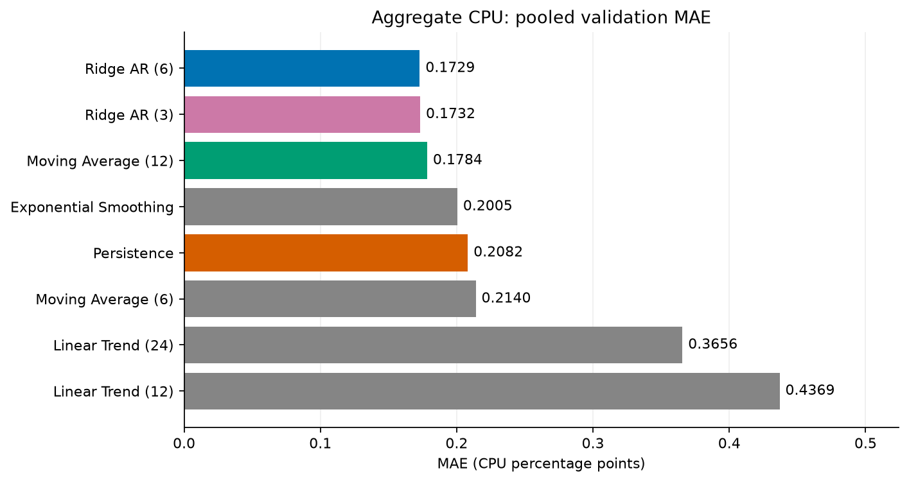
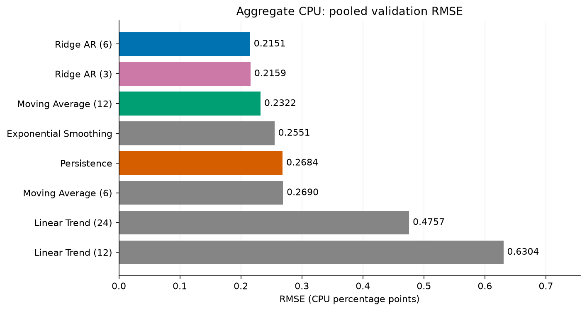
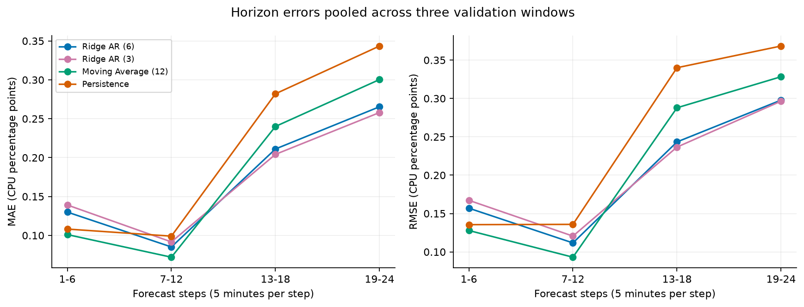
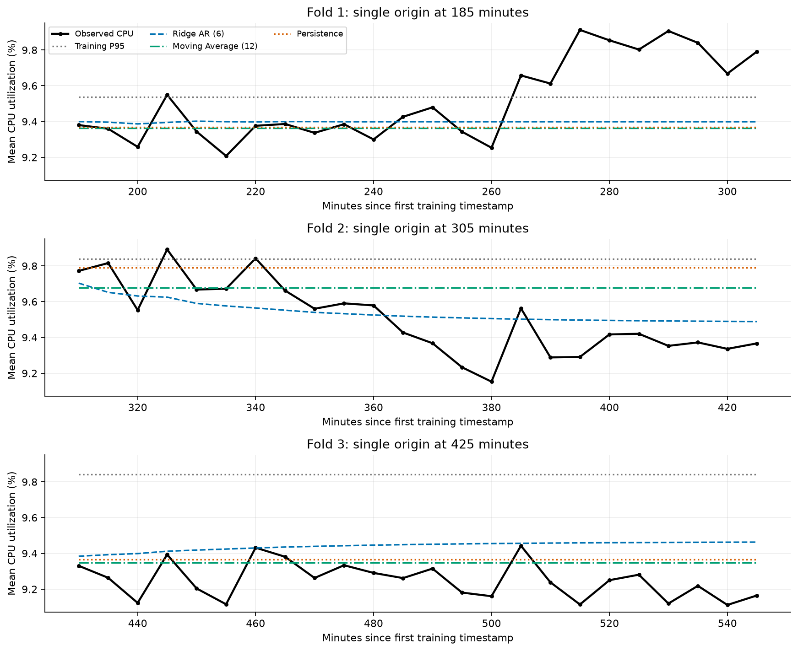
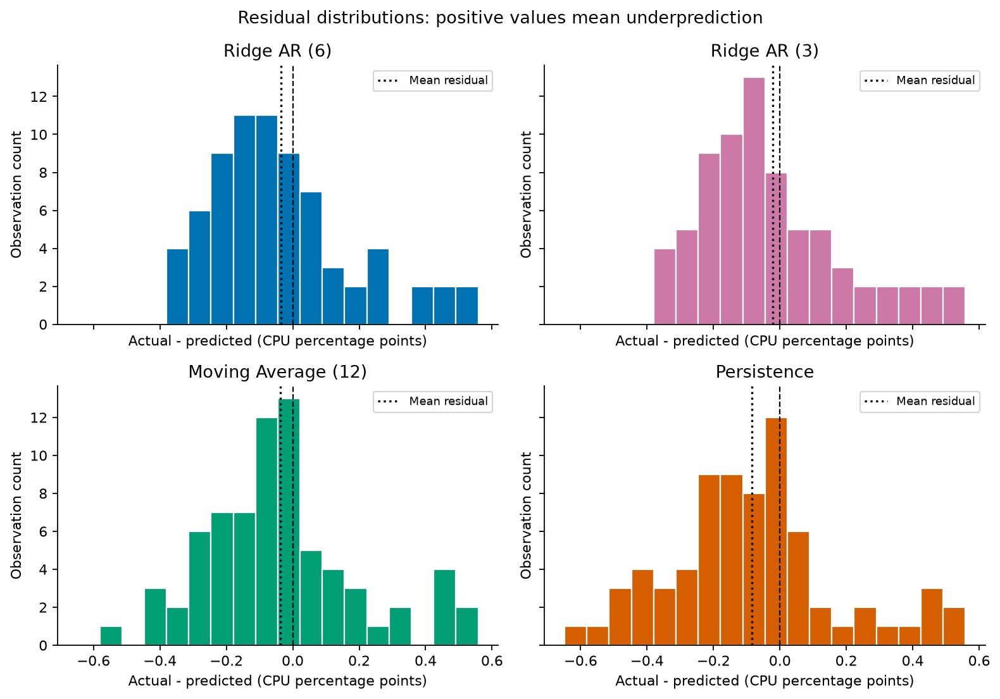
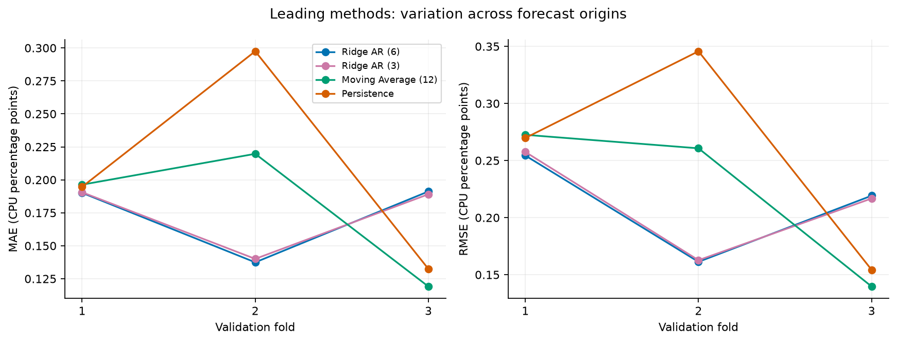
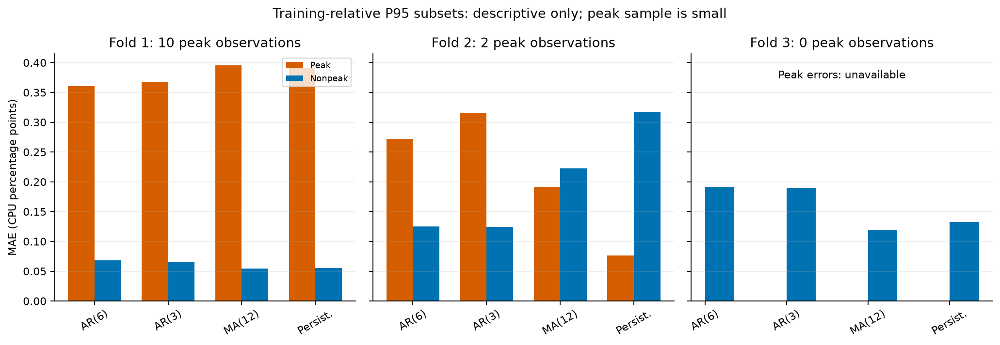

# Comprehensive model evaluation and error analysis (Step 5)

Supporting section for the final 4-6 page assignment report. Model choice is provisional; Step 6 and final holdout forecasting are outside this analysis.

## Evaluation methodology

Input: `outputs/train_targets.csv` (first 110 training observations only). Training mean CPU utilization is 9.41409%. Source-relative seconds are preserved; plots use minutes since the first training timestamp. No calendar dates are inferred.

| Fold | Training observations (1-based) | Validation observations (1-based) | Forecast length |
| --- | --- | --- | --- |
| 1 | 1-38 | 39-62 | 24 steps |
| 2 | 1-62 | 63-86 | 24 steps |
| 3 | 1-86 | 87-110 | 24 steps |

Every method predicts the same 24 future five-minute timestamps from one origin per fold. Validation windows do not overlap. Earlier validation observations become historical training data at later origins, as in deployment. No validation target is used as a recursive input within its own forecast. There is no shuffling, retuning or holdout evaluation.

Forecast implementations are reused from Steps 3-4: persistence; flat moving averages with windows 6/12; flat exponential smoothing with alpha=0.3 and adjust=False; linear trends fitted to the last 12/24 points; and centered ridge autoregressions with lags 3/6, alpha=1.0 and an unpenalized intercept. Trends and recursive ridge predictions retain their original [0,100] clipping. Ridge is refit using only available historical lag/target pairs at each origin. No future-derived features or full-trace metadata statistics are used.

MAE and RMSE are calculated from all 72 unrounded validation point predictions per CPU method. In particular, pooled RMSE is the square root of pooled squared errors, not the mean of fold RMSEs. CPU errors, bias and residual spread are in **percentage points**, while target values are percentages. Relative improvement = 100 x (persistence error - model error) / persistence error; negative values indicate deterioration. Zero baseline error produces N/A, including 0/0. Residual = actual - predicted: positive means underprediction; negative means overprediction.

## Model comparison and relative improvements

| model | mae | rmse | mae_improvement_pct | rmse_improvement_pct |
| --- | --- | --- | --- | --- |
| Ridge AR (6) | 0.17292 | 0.21507 | 16.94500 | 19.86393 |
| Ridge AR (3) | 0.17323 | 0.21586 | 16.79422 | 19.57082 |
| Moving Average (12) | 0.17838 | 0.23220 | 14.31963 | 13.48390 |
| Exponential Smoothing | 0.20048 | 0.25512 | 3.70927 | 4.94411 |
| Persistence | 0.20820 | 0.26839 | 0.00000 | 0.00000 |
| Moving Average (6) | 0.21401 | 0.26903 | -2.78926 | -0.23960 |
| Linear Trend (24) | 0.36564 | 0.47574 | -75.62170 | -77.25971 |
| Linear Trend (12) | 0.43693 | 0.63037 | -109.86162 | -134.87327 |

**Ridge AR (6)** has the lowest pooled MAE (0.17292) and pooled RMSE rank 1 (0.21507). Its MAE/RMSE improvements over persistence are 16.95%/19.86%. Its MAE advantage over Moving Average (12) is 3.06%.

The weakest pooled method is **Linear Trend (12)**, with MAE 0.43693 and RMSE 0.63037. Extrapolating a recent local slope over two hours is vulnerable to reversals; its large fold errors below are consistent with that failure mode. This is an interpretation of observed errors, not a causal test. The original method is retained and reported without corrective tuning.

## Fold-level performance and robustness

| model | Fold 1 MAE | Fold 1 RMSE | Fold 2 MAE | Fold 2 RMSE | Fold 3 MAE | Fold 3 RMSE |
| --- | --- | --- | --- | --- | --- | --- |
| Ridge AR (6) | 0.19012 | 0.25439 | 0.13744 | 0.16126 | 0.19119 | 0.21921 |
| Ridge AR (3) | 0.19056 | 0.25752 | 0.14006 | 0.16272 | 0.18908 | 0.21678 |
| Moving Average (12) | 0.19633 | 0.27254 | 0.21972 | 0.26071 | 0.11910 | 0.13963 |
| Exponential Smoothing | 0.19038 | 0.25524 | 0.28047 | 0.32706 | 0.13057 | 0.15212 |
| Persistence | 0.19468 | 0.26977 | 0.29749 | 0.34573 | 0.13243 | 0.15423 |
| Moving Average (6) | 0.19038 | 0.24464 | 0.31200 | 0.36172 | 0.13964 | 0.16260 |
| Linear Trend (24) | 0.19584 | 0.27157 | 0.61513 | 0.70913 | 0.28595 | 0.31996 |
| Linear Trend (12) | 0.15515 | 0.17810 | 0.93709 | 1.04746 | 0.21853 | 0.25138 |

| model | fold_count | fold_mae_mean | fold_mae_std | best_fold_mae | worst_fold_mae | worst_fold_rmse | fold_mae_wins |
| --- | --- | --- | --- | --- | --- | --- | --- |
| Ridge AR (6) | 3 | 0.17292 | 0.02509 | 0.13744 | 0.19119 | 0.25439 | 1 |
| Ridge AR (3) | 3 | 0.17323 | 0.02346 | 0.14006 | 0.19056 | 0.25752 | 0 |
| Moving Average (12) | 3 | 0.17838 | 0.04299 | 0.11910 | 0.21972 | 0.27254 | 1 |
| Persistence | 3 | 0.20820 | 0.06806 | 0.13243 | 0.29749 | 0.34573 | 0 |

Fold standard deviation is descriptive (ddof=0). Fold wins count the best MAE among all eight CPU methods, with ties shared; they are not significance tests.

Ridge AR (6) beats Moving Average (12) on MAE in 2 of the three windows. Their worst-fold MAEs are 0.19119 and 0.21972, respectively. The difference in pooled MAE between Ridge AR (6) and Ridge AR (3) is 0.00031. The small separation and changing fold rankings make the precise lag ranking uncertain. A lower fold-error spread alone can also reflect consistently poor predictions, so inspect it alongside absolute error levels.

Fold 1: best MAE is 0.15515 (Linear Trend (12)); Ridge AR (6) = 0.19012, Moving Average (12) = 0.19633.

Fold 2: best MAE is 0.13744 (Ridge AR (6)); Ridge AR (6) = 0.13744, Moving Average (12) = 0.21972.

Fold 3: best MAE is 0.11910 (Moving Average (12)); Ridge AR (6) = 0.19119, Moving Average (12) = 0.11910.

## Peak-demand error analysis

Each origin uses the linear-interpolated 95th percentile of its **training CPU window only**. A validation observation is a peak when actual >= that threshold, preserving the earlier evaluation convention. This threshold identifies unusually high aggregate utilization relative to historical training data; it is **not an infrastructure capacity limit**. Actual validation values classify errors after forecasting and never determine forecast inputs or thresholds.

| fold | peak_threshold | Peak count (of 24) |
| --- | --- | --- |
| 1 | 9.53607 | 10 |
| 2 | 9.83810 | 2 |
| 3 | 9.84165 | 0 |

Pooled peak and nonpeak errors (every observation uses its own origin's threshold):

| model | peak_count | peak_mae | peak_rmse | peak_mean_residual | nonpeak_count | nonpeak_mae | nonpeak_rmse | nonpeak_mean_residual |
| --- | --- | --- | --- | --- | --- | --- | --- | --- |
| Ridge AR (6) | 12 | 0.34613 | 0.36480 | 0.34613 | 60 | 0.13828 | 0.16998 | -0.11104 |
| Ridge AR (3) | 12 | 0.35835 | 0.37562 | 0.35835 | 60 | 0.13621 | 0.16643 | -0.09827 |
| Moving Average (12) | 12 | 0.36119 | 0.38561 | 0.36119 | 60 | 0.14182 | 0.18697 | -0.11695 |
| Exponential Smoothing | 12 | 0.31828 | 0.35113 | 0.31828 | 60 | 0.17692 | 0.23118 | -0.16502 |
| Persistence | 12 | 0.33801 | 0.37466 | 0.33801 | 60 | 0.18224 | 0.24159 | -0.16802 |
| Moving Average (6) | 12 | 0.29082 | 0.32853 | 0.29082 | 60 | 0.19864 | 0.25547 | -0.19175 |
| Linear Trend (24) | 12 | 0.34060 | 0.37794 | 0.31405 | 60 | 0.37065 | 0.49298 | -0.13680 |
| Linear Trend (12) | 12 | 0.16290 | 0.19622 | 0.06960 | 60 | 0.49173 | 0.68493 | -0.49170 |

Fold-specific peak/nonpeak errors for the leading methods (N/A means no qualifying observations):

| model | fold | subset | count | mae | rmse | mean_residual |
| --- | --- | --- | --- | --- | --- | --- |
| Moving Average (12) | 1 | peak | 10 | 0.39534 | 0.41359 | 0.39534 |
| Moving Average (12) | 1 | nonpeak | 14 | 0.05419 | 0.07178 | -0.01860 |
| Moving Average (12) | 2 | peak | 2 | 0.19049 | 0.19211 | 0.19049 |
| Moving Average (12) | 2 | nonpeak | 22 | 0.22238 | 0.26607 | -0.20103 |
| Moving Average (12) | 3 | peak | 0 | N/A | N/A | N/A |
| Moving Average (12) | 3 | nonpeak | 24 | 0.11910 | 0.13963 | -0.09725 |
| Persistence | 1 | peak | 10 | 0.39037 | 0.40885 | 0.39037 |
| Persistence | 1 | nonpeak | 14 | 0.05490 | 0.07323 | -0.02356 |
| Persistence | 2 | peak | 2 | 0.07619 | 0.08015 | 0.07619 |
| Persistence | 2 | nonpeak | 22 | 0.31760 | 0.36030 | -0.31533 |
| Persistence | 3 | peak | 0 | N/A | N/A | N/A |
| Persistence | 3 | nonpeak | 24 | 0.13243 | 0.15423 | -0.11725 |
| Ridge AR (3) | 1 | peak | 10 | 0.36685 | 0.38646 | 0.36685 |
| Ridge AR (3) | 1 | nonpeak | 14 | 0.06463 | 0.08368 | -0.04738 |
| Ridge AR (3) | 2 | peak | 2 | 0.31585 | 0.31585 | 0.31585 |
| Ridge AR (3) | 2 | nonpeak | 22 | 0.12408 | 0.14076 | -0.03171 |
| Ridge AR (3) | 3 | peak | 0 | N/A | N/A | N/A |
| Ridge AR (3) | 3 | nonpeak | 24 | 0.18908 | 0.21678 | -0.18897 |
| Ridge AR (6) | 1 | peak | 10 | 0.36093 | 0.38063 | 0.36093 |
| Ridge AR (6) | 1 | nonpeak | 14 | 0.06812 | 0.08630 | -0.05270 |
| Ridge AR (6) | 2 | peak | 2 | 0.27211 | 0.27216 | 0.27211 |
| Ridge AR (6) | 2 | nonpeak | 22 | 0.12520 | 0.14709 | -0.06088 |
| Ridge AR (6) | 3 | peak | 0 | N/A | N/A | N/A |
| Ridge AR (6) | 3 | nonpeak | 24 | 0.19119 | 0.21921 | -0.19104 |

There are only 12 distinct peak validation observations. Ridge AR (6) has peak MAE 0.34613, peak RMSE 0.36480, and peak mean residual 0.34613. Moving Average (12) has peak MAE 0.36119. The lowest pooled peak MAE is 0.16290 (Linear Trend (12)); peak performance alone does not offset poor overall performance. Positive peak bias indicates underprediction and suggests that a point forecast alone may provide insufficient headroom. No headroom policy is finalized in Step 5.

The primary model's peak MAE is +0.00812 relative to persistence (0.33801), while its peak RMSE is -0.00986 relative to persistence (0.37466). This peak comparison is a material limitation of the pooled ranking.

Peak plots are descriptive illustrations only: the subset is small, fold-dependent and temporally correlated. The figure omits missing peak bars rather than showing them as zero. Empty subsets remain count=0 and blank/NaN in CSVs. No peak uncertainty or reliable capacity guarantee can be estimated from these samples.

## Forecast horizon analysis

First versus second hour, pooled across folds (36 observations per hour per model):

| model | horizon_group | count | mae | rmse |
| --- | --- | --- | --- | --- |
| Exponential Smoothing | First hour | 36 | 0.10294 | 0.13044 |
| Exponential Smoothing | Second hour | 36 | 0.29801 | 0.33639 |
| Linear Trend (12) | First hour | 36 | 0.27063 | 0.36073 |
| Linear Trend (12) | Second hour | 36 | 0.60322 | 0.81523 |
| Linear Trend (24) | First hour | 36 | 0.18325 | 0.25025 |
| Linear Trend (24) | Second hour | 36 | 0.54804 | 0.62453 |
| Moving Average (12) | First hour | 36 | 0.08652 | 0.11184 |
| Moving Average (12) | Second hour | 36 | 0.27025 | 0.30874 |
| Moving Average (6) | First hour | 36 | 0.11749 | 0.14838 |
| Moving Average (6) | Second hour | 36 | 0.31052 | 0.35034 |
| Persistence | First hour | 36 | 0.10360 | 0.13568 |
| Persistence | Second hour | 36 | 0.31280 | 0.35448 |
| Ridge AR (3) | First hour | 36 | 0.11538 | 0.14578 |
| Ridge AR (3) | Second hour | 36 | 0.23108 | 0.26822 |
| Ridge AR (6) | First hour | 36 | 0.10757 | 0.13622 |
| Ridge AR (6) | Second hour | 36 | 0.23827 | 0.27195 |

Six-step blocks for the leading models (18 observations per block):

| model | horizon_group | count | mae | rmse |
| --- | --- | --- | --- | --- |
| Moving Average (12) | Steps 1-6 | 18 | 0.10107 | 0.12788 |
| Moving Average (12) | Steps 7-12 | 18 | 0.07198 | 0.09308 |
| Moving Average (12) | Steps 13-18 | 18 | 0.24010 | 0.28784 |
| Moving Average (12) | Steps 19-24 | 18 | 0.30039 | 0.32832 |
| Persistence | Steps 1-6 | 18 | 0.10815 | 0.13550 |
| Persistence | Steps 7-12 | 18 | 0.09905 | 0.13586 |
| Persistence | Steps 13-18 | 18 | 0.28209 | 0.34005 |
| Persistence | Steps 19-24 | 18 | 0.34350 | 0.36834 |
| Ridge AR (3) | Steps 1-6 | 18 | 0.13911 | 0.16723 |
| Ridge AR (3) | Steps 7-12 | 18 | 0.09165 | 0.12058 |
| Ridge AR (3) | Steps 13-18 | 18 | 0.20420 | 0.23660 |
| Ridge AR (3) | Steps 19-24 | 18 | 0.25797 | 0.29648 |
| Ridge AR (6) | Steps 1-6 | 18 | 0.12998 | 0.15697 |
| Ridge AR (6) | Steps 7-12 | 18 | 0.08515 | 0.11169 |
| Ridge AR (6) | Steps 13-18 | 18 | 0.21112 | 0.24335 |
| Ridge AR (6) | Steps 19-24 | 18 | 0.26542 | 0.29782 |

Ridge AR (6): second-hour minus first-hour MAE = +0.13071; RMSE = +0.13573. MAE across consecutive six-step blocks does not increase monotonically.

Ridge AR (3): second-hour minus first-hour MAE = +0.11570; RMSE = +0.12244. MAE across consecutive six-step blocks does not increase monotonically.

Moving Average (12): second-hour minus first-hour MAE = +0.18372; RMSE = +0.19690. MAE across consecutive six-step blocks does not increase monotonically.

Persistence: second-hour minus first-hour MAE = +0.20920; RMSE = +0.21880. MAE across consecutive six-step blocks does not increase monotonically.

Horizon groups describe realized errors on these particular workload trajectories; a longer lead time does not necessarily produce a monotonically larger error. These three windows cannot establish a general error-growth law.

## Residual and absolute-error analysis

Population residual SD uses ddof=0. Largest positive/negative residuals identify the most severe under/overprediction; a missing sign is N/A. Absolute-error percentiles are empirical descriptive summaries, not prediction intervals.

| model | mean_residual | residual_std | largest_positive_residual | largest_negative_residual | absolute_error_median | absolute_error_p90 | absolute_error_p95 | absolute_error_max |
| --- | --- | --- | --- | --- | --- | --- | --- | --- |
| Moving Average (12) | -0.03726 | 0.22919 | 0.54822 | -0.52383 | 0.12590 | 0.42307 | 0.48234 | 0.54822 |
| Persistence | -0.08368 | 0.25501 | 0.54326 | -0.63813 | 0.16228 | 0.46943 | 0.51818 | 0.63813 |
| Ridge AR (3) | -0.02217 | 0.21472 | 0.51976 | -0.34519 | 0.13618 | 0.33955 | 0.42692 | 0.51976 |
| Ridge AR (6) | -0.03484 | 0.21223 | 0.51347 | -0.35269 | 0.14563 | 0.35021 | 0.42060 | 0.51347 |

Mean residual by fold (positive = average underprediction, negative = average overprediction):

| model | fold | mean_residual | residual_std | underprediction_count | overprediction_count |
| --- | --- | --- | --- | --- | --- |
| Moving Average (12) | 1 | 0.15387 | 0.22495 | 16 | 8 |
| Moving Average (12) | 2 | -0.16841 | 0.19902 | 4 | 20 |
| Moving Average (12) | 3 | -0.09725 | 0.10020 | 4 | 20 |
| Persistence | 1 | 0.14891 | 0.22495 | 16 | 8 |
| Persistence | 2 | -0.28270 | 0.19902 | 3 | 21 |
| Persistence | 3 | -0.11725 | 0.10020 | 4 | 20 |
| Ridge AR (3) | 1 | 0.12521 | 0.22503 | 12 | 12 |
| Ridge AR (3) | 2 | -0.00275 | 0.16269 | 11 | 13 |
| Ridge AR (3) | 3 | -0.18897 | 0.10623 | 1 | 23 |
| Ridge AR (6) | 1 | 0.11965 | 0.22449 | 12 | 12 |
| Ridge AR (6) | 2 | -0.03313 | 0.15782 | 11 | 13 |
| Ridge AR (6) | 3 | -0.19104 | 0.10750 | 1 | 23 |

Ridge AR (6): pooled bias -0.03484; average underprediction in 1 folds and average overprediction in 2 folds. There are 24 point underpredictions and 48 point overpredictions out of 72.

Ridge AR (3): pooled bias -0.02217; average underprediction in 1 folds and average overprediction in 2 folds. There are 24 point underpredictions and 48 point overpredictions out of 72.

Moving Average (12): pooled bias -0.03726; average underprediction in 1 folds and average overprediction in 2 folds. There are 24 point underpredictions and 48 point overpredictions out of 72.

Persistence: pooled bias -0.08368; average underprediction in 1 folds and average overprediction in 2 folds. There are 23 point underpredictions and 49 point overpredictions out of 72.

Ridge AR (6), largest residual: +0.51347 at source-relative timestamp 16500 seconds (fold 1, forecast step 18); actual 9.91218%, prediction 9.39871%.

Ridge AR (6), smallest residual: -0.35269 at source-relative timestamp 22800 seconds (fold 2, forecast step 15); actual 9.15275%, prediction 9.50544%.

Fold biases and the extreme cases show why pooled bias alone can hide failures in opposite directions. Residual serial dependence is plausible for multistep forecasts; the histogram does not establish independent or normally distributed errors.

## Active VM count (evaluated separately)

| model | fold | count | mae | rmse |
| --- | --- | --- | --- | --- |
| Persistence | 1 | 24 | 0.00000 | 0.00000 |
| Persistence | 2 | 24 | 0.00000 | 0.00000 |
| Persistence | 3 | 24 | 0.00000 | 0.00000 |

Training VM count ranges from 10000 to 10000 and has 1 distinct value(s). Persistence has pooled MAE 0.00000 VMs and RMSE 0.00000 VMs. Its relative improvements are undefined because baseline error is zero. A constant forecast is justified for this curated, fixed challenge population and its observed training behavior. This is not evidence that real cloud deployments have no VM churn, nor a claim about unseen holdout performance.

## Provisional model selection recommendation

Use **Ridge AR (6) for aggregate CPU utilization**, with **Moving Average (12) as the fallback baseline**, and **persistence for active VM count**. The CPU recommendation prioritizes pooled MAE (0.17292), considers pooled RMSE (0.21507), and recognizes the 2/3 fold MAE wins over the fallback and the worst-fold comparisons above. The ridge models fit small regularized linear systems and need only the available CPU history; moving averages have even lower complexity and no fitted lag coefficients. Fixed ridge regularization is useful given short training windows, but it does not eliminate overfitting or recursive error accumulation.

Moving Average (12) is reasonable when fitted autoregressive behavior is unstable or a simpler operational baseline is desired. Its lower third-window MAE is a material counterexample to a universal advantage for the primary model. Peak errors and horizon behavior remain risks for the primary model. The observed difference between Ridge AR (3) and Ridge AR (6), documented above, is insufficient to establish a reliable lag preference on other data. The preferred model is not a reliable peak-capacity predictor, and the trend model's peak results do not rescue its large overall errors. This is a validation-based engineering judgment, not a statistical-significance claim.

## Limitations, risks and next-stage boundary

Only three correlated forecast origins and 110 five-minute training observations are available. The validation set has 72 distinct timestamps, not hundreds of independent observations merely because multiple models predict them. Training windows overlap, ranking may change with new windows, and there is insufficient history to justify daily/weekly seasonality or strong generalization claims. Selection uses the same validation windows as the earlier model exploration, so validation selection optimism remains possible. No significance test or resampling-based ranking confidence is claimed.

The unweighted VM mean is not a core-weighted measure of infrastructure capacity; aggregate smoothness can conceal individual VM or segment spikes. P95 peaks reflect this short, curated population and can shift as the training window expands. Short-window trend extrapolation and nearly stationary recursive ridge forecasts can both miss workload shifts. A constant active population limits what can be learned about churn.

**Holdout audit:** this Step 5 execution reads only the capped training-target CSV, not raw traces, holdout timestamps or observations 111-134. The final 24 observed target values were neither accessed nor used for fitting, features, tuning, thresholds, selection or conclusions. No final `predictions.csv` is generated. Earlier EDA code constructs the complete target series before splitting as required by the assignment; this step does not rerun that code or re-open its raw inputs.

Step 5 is complete when the documented command and automated tests pass. The project is ready for review before Step 6; operational policy, final model fitting, final prediction export and any authorized final holdout assessment remain for the next stage.

## Reproduction and artifacts

From the repository root, after `python -m pip install -e ".[dev]"`:

```powershell
python -m cwfc.error_analysis
python -m pytest -q -p no:cacheprovider
```

The analysis accepts `--input`, `--output-dir` and `--report-dir`. Input must contain the first 110 chronological training observations at five-minute cadence; parsing is capped at 110 rows and shorter inputs fail validation. No sorting, resampling or imputation is performed.

Outputs: `model_comparison.csv`, `fold_performance.csv`, `horizon_error_analysis.csv`, `peak_error_analysis.csv`, `residual_analysis.csv`, `model_robustness.csv`, `evaluation_validation_predictions.csv` and `evaluation_manifest.json` under `outputs/`. The manifest records configuration, dependency versions and a SHA256 digest of the validated training data. `fold=0` denotes pooled rows in peak/residual CSVs. CSVs preserve full precision; this report rounds displayed values. Previous baseline/advanced evaluation files and EDA figures are preserved.

## Figures














