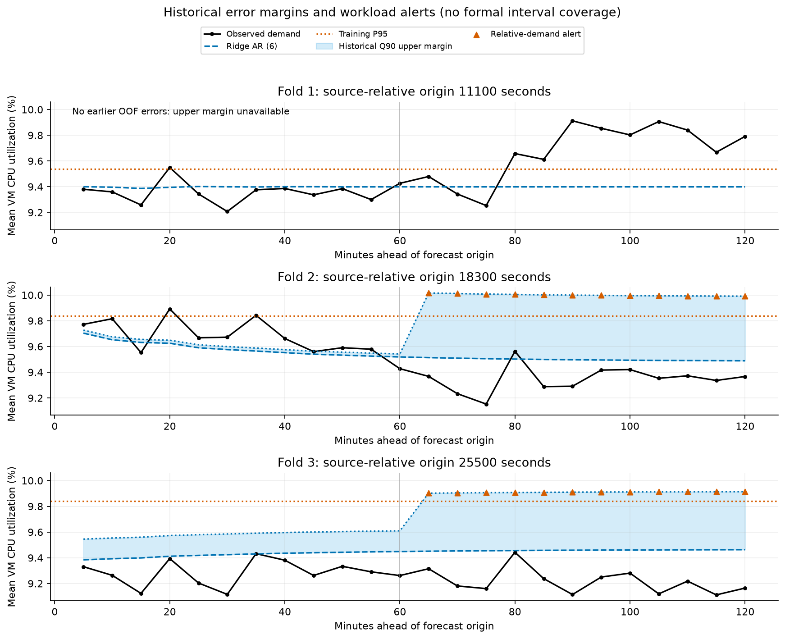
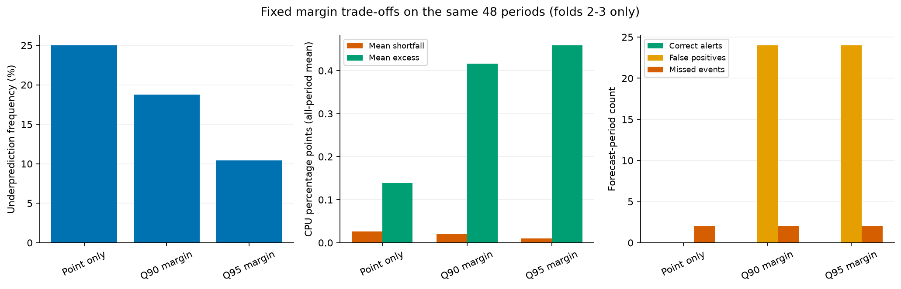
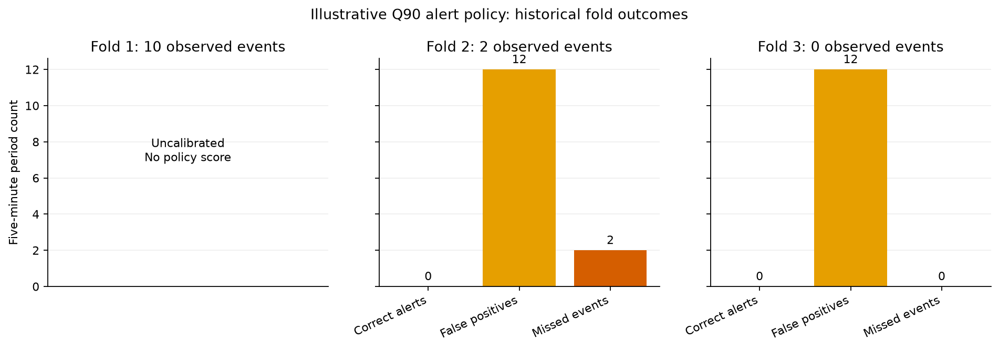

# Forecast-based operational recommendations (Step 6)

Supporting material for the final assignment report. **Recommendation: use this policy in shadow monitoring only; do not connect it to automatic scaling.** The uncertainty margins reduced numerical shortfalls, but the alert replay did not identify any of the evaluable high-demand events. No new model, model tuning, final forecast or Step 7 work is included.

## Purpose and what the targets mean

Forecasting gives a monitoring team advance notice to investigate demand changes, check headroom and prepare a response. The selected CPU method remains Ridge AR (6), Moving Average (12) remains its fallback, and VM-count persistence remains unchanged. Step 5 found good average CPU accuracy but weaker peak behavior and longer-horizon errors; an accurate average forecast is insufficient evidence for an operational scaling controller.

Aggregate CPU utilization is the **unweighted mean of VM-level average CPU percentages**. It is not core-weighted CPU demand, physical server utilization, total cluster usage, available capacity or a server-count requirement. Different VM sizes and memory configurations make a direct conversion invalid. `active_vm_count` counts distinct VMs with valid readings, not hosts, scaling demand or spare capacity. Its constant training value reflects this curated population; it does not show that real clouds lack churn.

## Fixed illustrative monitoring policy

The following rules are engineering assumptions chosen for illustration before the policy replay, not thresholds optimized against its results. The proposed illustration uses Q90 residual margins; Q95 is a fixed sensitivity comparison and point-only is a comparator. Neither empirical quantile denotes guaranteed prediction-interval coverage.

At each origin, derive T = linear-interpolated training CPU P95. Separately for steps 1-12 and 13-24, take the empirical Q90 of **signed** same-model residuals already observed at that origin: m = max(0, Q90(actual - predicted)). Construct U = clip(predicted + m, 0, 100). Quantiles include negative and zero errors; they are not calculated from positive errors alone. Errors and margins are CPU percentage points; T and forecasts are CPU percentages.

| Level | Exact condition at a forecast period | Monitoring response |
| --- | --- | --- |
| Normal | U < T | Continue routine monitoring; this does not certify infrastructure health. |
| Elevated demand | U >= T, before the sustained point-exceedance rule applies | Inspect high-load VMs and categories; increase monitoring frequency as an illustrative action. |
| High-risk condition | Point forecast >= T for at least 3 consecutive five-minute steps at this origin | Investigate actual headroom, service latency and contention; consider scaling or redistribution only if real capacity metrics support it. |

The 3-step rule represents a prespecified 15-minute sustained forecast condition, not an empirically optimal duration. The first two exceeding steps remain Elevated; High-risk starts on the third and continues while point exceedances persist. Runs reset when the point forecast falls below T and at each new origin, including across folds. They may span the first/second-hour boundary within one origin. Repeated upper-bound exceedances alone do not trigger High-risk. A High-risk label still describes relative workload risk, not confirmed physical saturation. No infrastructure-capacity verification signal is present or synthesized in this implementation.

If no earlier OOF errors exist for either hour, the empirical policy is **Uncalibrated**, rather than Normal with a zero margin. A point-only comparison remains available, but it offers no uncertainty protection. In deployment, first collect resolved forecast errors and retain ordinary telemetry alerts during this warm-up. Recalculate forecasts when new measurements arrive and deduplicate notifications in a real monitoring service; these notification semantics are not simulated here.

## Exact thresholds and origin-available margins

The P95 threshold is a **relative historical high-demand threshold, not a physical infrastructure capacity limit**. The inclusive >= comparison preserves Step 5's event definition. Every fold uses its own training window; no validation targets determine its threshold. Values below are rounded to eight decimals; CSVs retain full precision.

| fold | train_size | origin_timestamp | horizon_group | threshold | sample_count | margin_q90 | margin_q95 |
| --- | --- | --- | --- | --- | --- | --- | --- |
| 1 | 38 | 11100 | First hour | 9.53607490 | 0 | N/A | N/A |
| 1 | 38 | 11100 | Second hour | 9.53607490 | 0 | N/A | N/A |
| 2 | 62 | 18300 | First hour | 9.83810370 | 12 | 0.02335514 | 0.08460096 |
| 2 | 62 | 18300 | Second hour | 9.83810370 | 12 | 0.50224879 | 0.51016798 |
| 3 | 86 | 25500 | First hour | 9.84165272 | 24 | 0.16090664 | 0.25124935 |
| 3 | 86 | 25500 | Second hour | 9.84165272 | 24 | 0.45105911 | 0.49963834 |
| 4 | 110 | 32700 | First hour | 9.82914646 | 36 | 0.13215290 | 0.18943265 |
| 4 | 110 | 32700 | Second hour | 9.82914646 | 36 | 0.42247993 | 0.46831299 |

The row marked fold 4/train size 110 documents parameters available after the complete training window only: T = 9.82914646%. No next-window forecasts are generated and no holdout values are opened. Fallback calibration parameters are also recorded in `uncertainty_analysis.csv`; a fallback must use its own residual margins rather than inheriting Ridge's errors.

## Calibration chronology and uncertainty limitations

Reuse the existing saved expanding-window OOF predictions; verify their timestamps, 24-step alignment, target values and origins against the training-only data and verify the Step 5 manifest. No forecasting method is refit. For an origin at t, calibration admits only same-model errors whose observed timestamp <= t and whose original forecast origin < t. Thus fold 2 uses resolved fold-1 errors, fold 3 uses resolved folds 1-2, and fold 1 has no calibration data. Short- and long-horizon samples are kept separate. Current-fold residuals are never used for its margin, and calibration labels record the latest error timestamp for audit.

The replay assumes readings through the latest training timestamp have arrived when the forecast is issued. A live implementation must check measurement arrival times and exclude delayed observations even when their source timestamp is earlier than the origin.

The uncertainty CSV separates `origin_calibration` from `descriptive_oof`. Pooled/per-fold retrospective residual summaries below are diagnostics, not margins applied back to those same predictions. Only origin-available samples drive historical alerts. Margin samples are small and temporally dependent; adjacent forecast errors share a fitted model and often a common workload shift. Training windows also overlap. The primary model was selected using these same validation windows, so calibration and replay remain subject to model-selection optimism despite forward-only margin construction. No conformal, normality, independence or formal 90%/95% coverage claim is made.

| fold | horizon_group | sample_count | mean_residual | residual_std | signed_q90 | signed_q95 |
| --- | --- | --- | --- | --- | --- | --- |
| 0 | All steps | 72 | -0.03484 | 0.21223 | 0.26893 | 0.42060 |
| 0 | First hour | 36 | -0.03118 | 0.13260 | 0.13215 | 0.18943 |
| 0 | Second hour | 36 | -0.03850 | 0.26921 | 0.42248 | 0.46831 |
| 1 | All steps | 24 | 0.11965 | 0.22449 | 0.45106 | 0.49964 |
| 1 | First hour | 12 | -0.03858 | 0.08144 | 0.02336 | 0.08460 |
| 1 | Second hour | 12 | 0.27787 | 0.20997 | 0.50225 | 0.51017 |
| 2 | All steps | 24 | -0.03313 | 0.15782 | 0.14753 | 0.25125 |
| 2 | First hour | 12 | 0.08510 | 0.10847 | 0.25640 | 0.27157 |
| 2 | Second hour | 12 | -0.15136 | 0.10047 | -0.07355 | -0.01295 |
| 3 | All steps | 24 | -0.19104 | 0.10750 | -0.02883 | -0.01444 |
| 3 | First hour | 12 | -0.14005 | 0.09448 | -0.02182 | -0.00926 |
| 3 | Second hour | 12 | -0.24202 | 0.09481 | -0.14044 | -0.08103 |

Q95 uses the extreme tail of very few observations, so it can be especially unstable. Hour-specific quantiles describe historical errors, not a law requiring every later-origin margin to grow with horizon. Regime changes can make past upper margins unrepresentative.

## Historical policy evaluation

The point-only comparator covers all 72 validation periods with 12 observed P95 events. The empirical policies cannot be evaluated on fold 1. The fair, common comparison uses only 48 periods in folds 2-3, containing 2 observed elevated-demand periods. Do not compare rates from the 72-period point-only sample directly against the 48-period calibrated sample.

Metric definitions: an alert period is a five-minute forecast timestamp classified Elevated or High-risk. An observed event is actual >= origin-specific T. TP is an alerted event; FP an alert without an event; FN an event without an alert; TN neither. Alert rate = alerts/N, precision = TP/(TP+FP), recall = TP/(TP+FN), and false-positive rate = FP/(FP+TN). Zero denominators are N/A. An episode is a contiguous alert run within one origin; forecast-period counts are not numbers of notifications or servers. Uncalibrated policies have no score, not zero-error performance.

Common-origin event results:

| policy | evaluated_count | observed_elevated_count | alert_count | alert_episodes | high_risk_count | true_positive | false_positive | false_negative | true_negative | precision | recall | false_positive_rate |
| --- | --- | --- | --- | --- | --- | --- | --- | --- | --- | --- | --- | --- |
| point_only | 48 | 2.00000 | 0.00000 | 0.00000 | 0.00000 | 0.00000 | 0.00000 | 2.00000 | 46.00000 | N/A | 0.00000 | 0.00000 |
| historical_q90 | 48 | 2.00000 | 24.00000 | 2.00000 | 0.00000 | 0.00000 | 24.00000 | 2.00000 | 22.00000 | 0.00000 | 0.00000 | 0.52174 |
| historical_q95 | 48 | 2.00000 | 24.00000 | 2.00000 | 0.00000 | 0.00000 | 24.00000 | 2.00000 | 22.00000 | 0.00000 | 0.00000 | 0.52174 |

Q90 results by fold (candidate observed events are shown even when calibration is unavailable):

| fold | candidate_count | evaluated_count | candidate_observed_elevated_count | observed_elevated_count | alert_count | true_positive | false_positive | false_negative |
| --- | --- | --- | --- | --- | --- | --- | --- | --- |
| 1 | 24 | 0 | 10 | N/A | N/A | N/A | N/A | N/A |
| 2 | 24 | 24 | 2 | 2.00000 | 12.00000 | 0.00000 | 12.00000 | 2.00000 |
| 3 | 24 | 24 | 0 | 0.00000 | 12.00000 | 0.00000 | 12.00000 | 0.00000 |

On the common sample, Q90 produced 24 alert periods in 2 episodes: 0 correct alerts, 24 false positives and 2 missed events. It produced 0 sustained point-exceedance High-risk periods. Q95 produced 24 alerts, 0 correct alerts and 2 misses. These are workload-event labels, not verified service incidents or capacity shortfalls.

The uncertainty margins reduced numerical shortfalls, but the alert replay did not identify any of the evaluable high-demand events. Broad long-horizon margins can warn about a workload rise at the wrong time, while a small short-horizon margin can miss an early spike. Review the timestamp-level CSV and forecast/threshold plot for these cases. The thin event sample makes precision, recall and false-positive rates unreliable estimates for future operations. Keep the disappointing results visible; no extra threshold or persistence search is performed to improve them.

## Safety-margin and signed-error trade-offs

Underprediction rate = fraction with actual > conservative forecast; overprediction rate = fraction with actual < conservative forecast. Average positive forecast error = mean(max(actual - conservative forecast, 0)) across **all** evaluated periods. The conditional mean when underpredicted is separately available in CSVs. Average excess = mean(max(conservative forecast - actual, 0)); average conservative margin = mean(conservative forecast - point forecast) after clipping. These quantities are in percentage points and do not measure physical under/over-provisioning.

| policy | evaluated_count | underprediction_rate | overprediction_rate | average_positive_forecast_error | average_excess | mean_residual | average_conservative_margin | alert_rate |
| --- | --- | --- | --- | --- | --- | --- | --- | --- |
| point_only | 48 | 0.25000 | 0.75000 | 0.02612 | 0.13820 | -0.11209 | 0.00000 | 0.00000 |
| historical_q90 | 48 | 0.18750 | 0.81250 | 0.02002 | 0.41650 | -0.39648 | 0.28439 | 0.50000 |
| historical_q95 | 48 | 0.10417 | 0.89583 | 0.01023 | 0.45873 | -0.44850 | 0.33641 | 0.50000 |

Across all 72 OOF point forecasts, Ridge underpredicts 24 times (33.33%) and overpredicts 48 times; pooled signed bias = -0.03484. An overall negative bias can coexist with underprediction of peaks; Step 5 documents that distinction.

On the common sample, adding Q90 changes underprediction frequency from 25.00% to 18.75%, mean shortfall from 0.02612 to 0.02002, and mean excess from 0.13820 to 0.41650. Q95 changes the underprediction frequency to 10.42% with mean excess 0.45873. Larger historical margins reduce numerical underprediction here, but do not necessarily detect more events or improve alert precision. The illustrated quantile choices remain unchanged by these results.

## Under-provisioning, over-provisioning and category considerations

In a real system, insufficient resources may cause contention, latency, performance degradation and reduced reliability during spikes. Excess resources may leave idle capacity, raise expenditure and create unnecessary scaling activity. A larger uncertainty margin places more weight on avoiding shortfalls but can increase investigation effort and false alerts. The preferred operating point depends on service-level objectives, workload criticality, response lead time and infrastructure economics. This dataset supplies neither those costs nor measured latency, capacity headroom or scaling outcomes; no financial saving, pricing assumption or physical capacity benefit is estimated.

The existing category EDA uses training readings only. Its means are descriptive:

| vm_category | Training mean VM CPU (%) |
| --- | --- |
| Interactive | 11.50515 |
| Unknown | 10.35469 |
| Delay-insensitive | 8.25727 |

Interactive workloads may warrant closer latency monitoring and more conservative protection **if their actual SLOs justify it**. Delay-insensitive workloads may permit deferral or scheduling flexibility after checking deadlines and dependencies. Unknown workloads need classification before confident policy assignment. These are operational interpretations, not causal evidence that category membership determines latency sensitivity or spare capacity. Category means do not validate segment-specific alert thresholds, and no new segment forecasting models are introduced.

## Applying this to a real cloud environment

Start with shadow alerts and log point forecasts, the origin-available margin, threshold, observed demand and operator outcomes. Collect CPU-core allocations and usage, exact VM sizes, placement, host/cluster headroom, throttling, runnable queues, memory/IO pressure, application latency/error rates, service dependencies and scaling lead times. Use these signals to establish genuine capacity limits and verify service risk before scaling or redistributing work. The aggregate mean can hide a saturated VM or bottleneck even while relative-demand alerts stay Normal.

Collect more independent forecast windows and high-load incidents before choosing alert quantiles or run lengths. Reserve a later prospective period to evaluate a frozen policy and notification deduplication. Calibrate each deployed model and monitor drift, missed events and alert fatigue; if the CPU model fails or required lag history is unavailable, use the validated Moving Average (12) fallback with its own calibration and retain ordinary monitoring. The present replay does not validate automated failover or notification handling.

## Reproduction, audit and stage boundary

From the repository root, with the existing environment and Step 5 artifacts:

```powershell
python -m cwfc.operational_policy
python -m pytest -q -p no:cacheprovider
```

The command accepts `--training`, `--predictions`, `--evaluation-manifest`, `--categories`, `--output-dir` and `--report-dir`. It writes `outputs/uncertainty_analysis.csv`, `outputs/operational_policy_validation.csv`, `outputs/policy_summary.csv`, `outputs/operational_policy_manifest.json`, this report and three `reports/figures/operational_*.png` figures. CSV rates are fractions, not percentages; report values are rounded. The manifest records fixed policy settings, dependency versions and input digests. Step 5's residual-distribution plot is reused when present. Earlier artifacts are preserved.

**Holdout audit:** only the capped 110-row training-target artifact, saved validation predictions, Step 5 manifest and training-category statistics are read. No raw VM traces, holdout timestamps or final 24 observed holdout targets are opened or used. No model or hyperparameter changes, formal coverage claims, final `predictions.csv`, live infrastructure actions or cost estimates are produced. Step 6 is ready for review after checks pass; Step 7 and final submission remain unstarted.

## Figures







The existing residual-distribution plot uses actual - predicted; positive errors are underprediction. It includes the primary method and provides the signed-error context without generating a duplicate figure.


